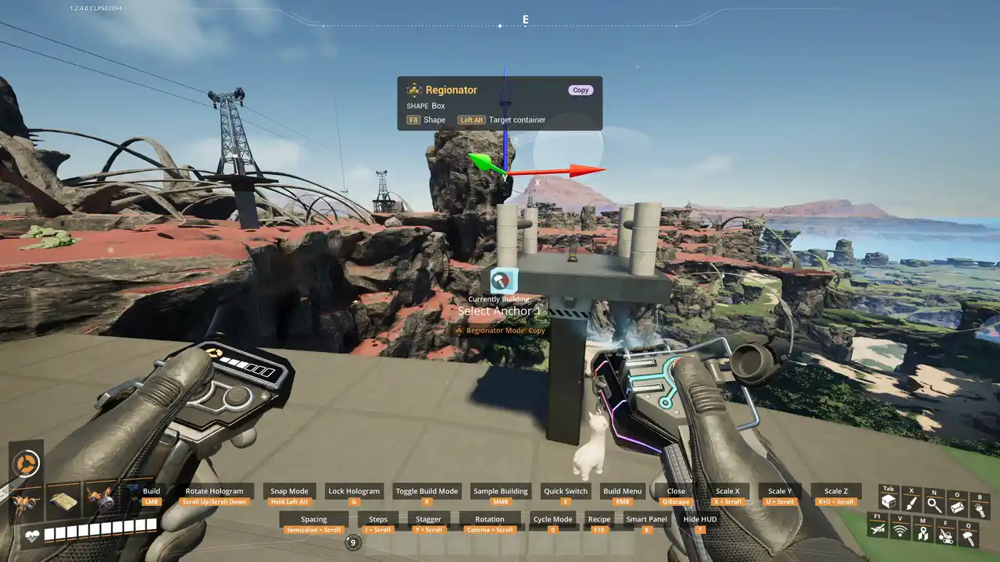

# Auto Pillars

Mark the pillars of a blueprint while you save or copy it. Wherever the blueprint is placed, the
marked columns reach down to the ground. The extra pieces are added to the cost and built with the
blueprint.

Off by default: switch it on under **Mods > Regionator > General > Enable auto pillars**.

## Marking

1. In [Save Blueprint](Save-Blueprint) or [Copy](Copy), draw the selection until both corners of a
   region are down.
2. Press **Regionator: mark auto pillars** (`Left Ctrl + P`, or `L3 + LT` on a controller). A teal
   marking region starts.
3. Place its two corners around the pillars that should reach down, the same way as any region.
   Selected buildings are outlined red; marked ones turn blue, and yellow ones cannot extend (the
   [HUD](Regionator-HUD) says why).
4. Click to confirm the whole selection, marks included.

You can draw several marking regions. They only mark what the selection already holds. Marking is
not offered in Move.

## Placing

The hologram shows each marked column reaching down to the ground, or to a lower floor of the same
blueprint, and the cost follows as you move it. Dismantling the blueprint takes the extra pieces
down too. A saved blueprint keeps its marks for every later placement.

## What extends

A column is a stack of marked pieces along one line: an upright pillar, a slanted support, or a
vertical or slanted beam. A column made of several pieces stacked together is repeated as a whole.

A column does not extend when:

- it holds belts, pipes, railways or power lines;
- it has a gap, or a piece less than 10 cm tall along it (a flat roof, thin trim);
- it already stands on another building of the blueprint;
- nothing solid is within 1 km below it, or it would pass through another column.

One placement adds at most 5000 extra pieces. Raise **Auto pillar limit** in the Mods menu for
very tall builds; a column that would go past it does not extend at all.

## Notes

- Re-saving a blueprint in the Blueprint Designer drops its marks.
- In multiplayer each player's own **Enable auto pillars** setting applies, but the host's limit
  applies to everyone.
