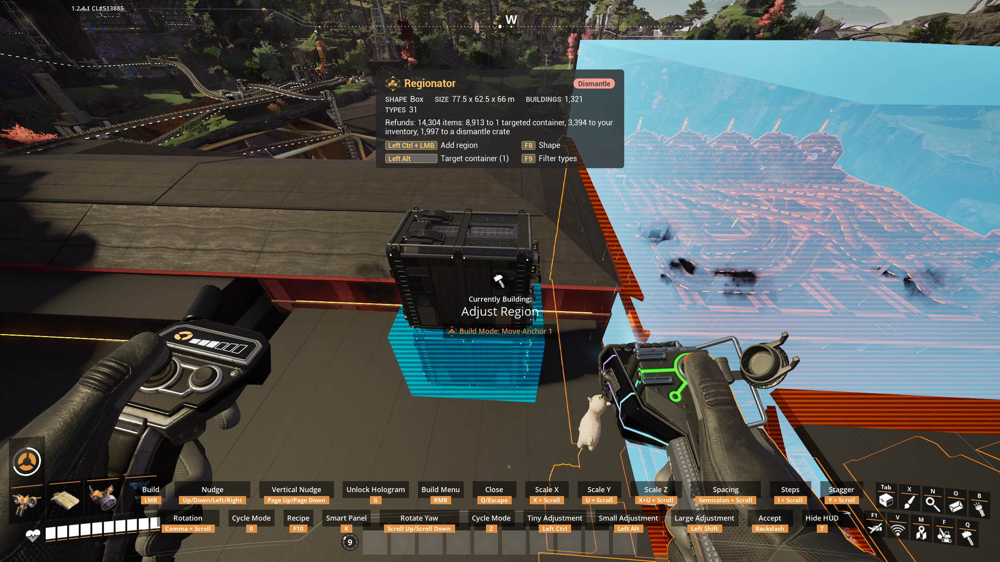

# Container Targeting

Pay for builds from storage containers, and send refunds to them, instead of your inventory.

Building a blueprint bigger than your inventory can carry? Load the items into a container and
target it while the hologram is in hand.

## How to use it

1. Aim at a storage container or a dismantle crate.
2. Tap **Regionator: target hovered container** (`Left Alt`). Tap again to untarget it. Targets
   are outlined so they stand out from a distance.

Up to 64 containers can be targeted. The Dimensional Depot and death crates cannot be. The key
works with the tool, any blueprint hologram (including ones from the blueprint menu), and the
game's own dismantle tool.

## What goes through the targets

- **Refunds and removed items** ([Dismantle](Dismantle), [Clear Items](Clear-Items),
  [Replace](Replace), [Move](Move)): targets first, then your inventory, then a crate. Never the
  Dimensional Depot.
- **Building costs** ([Copy](Copy), [Replace](Replace), blueprints from the menu): targets first,
  then your inventory and the Dimensional Depot.
- **[Fill Inputs](Fill-Inputs)**: targets first, then your inventory. The Depot is not used.

The [HUD](Regionator-HUD) shows where things will go before you confirm.

## Safety

A container inside the region cannot be targeted, and a target is never dismantled or moved.
Targets are released when you put the tool or hologram away, or when the operation that used
them finishes. A Copy keeps them for every placement until you put the hologram away.
