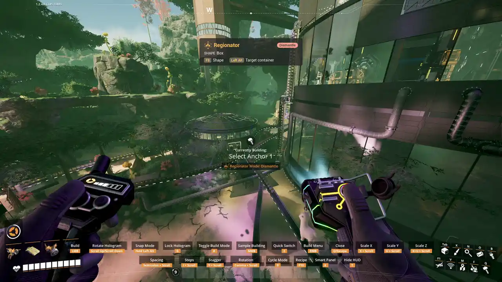

# Regions

A region picks the buildings an operation acts on. A building is selected when the region touches
any part of it.

## Boxes

A box is set by two opposite corners, called anchors. Each corner goes exactly where you aim,
high or low, so the box is as tall as the gap between them: aim the first at a floor and the
second at a roof to take in every level.

1. Click to place the first corner. Aimed at a building, the box turns to match it (**Snap
   rotation to highlighted building** in the Mods menu).
2. Aim for the second corner. Everything inside is outlined and the [HUD](Regionator-HUD) counts
   it. Click to place it.
3. The region locks so you can adjust it. The game's nudge keys move it, and the build-mode key
   picks what they move: **Move Region**, **Move Anchor 1** (the first corner) or **Move Anchor
   2** (the second). Scroll rotates it.
4. Click to confirm.

Before you confirm, secondary fire steps back one stage: from the locked region to placing the
second corner, then to the first.

## Spheres

`Left Ctrl + B` (`L3 + Y` on a controller) switches between box and sphere. For a sphere, the first
anchor is the center and the second sets the radius. While locked, the nudge targets are **Move
Center** and **Adjust Radius**.

## Several regions

With both anchors placed, `Left Ctrl + N` (`L3 + A`) freezes the current region and starts another.
There is no limit, and boxes and spheres mix freely. A building inside two regions counts once.

## Volume limit

All your regions together may enclose at most a 500 x 500 x 500 m box, or the same volume in any
shape. Raise it with **Selection volume limit factor** in the Mods menu, which sets the side of
that cube in meters. Over the limit, the region turns red and cannot be confirmed.
