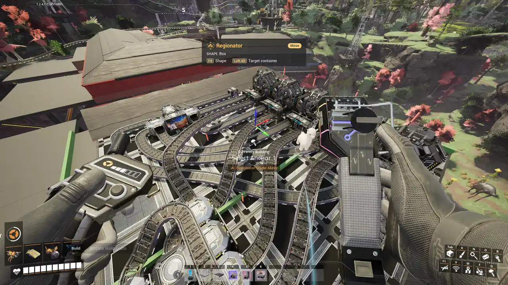

# Clear Items

Empties machines, belts and pipes, picks up dropped items and clears dismantle crates. Items go to
[targeted containers](Container-Targeting), then your inventory, then a crate at your feet. Fluid
is deleted.

## How to use it

1. Pick **Clear items**, draw a [region](Regions), confirm.
2. The HUD shows what comes out and where it goes.

## What is emptied

- Machine inputs, outputs and fuel, including train, truck and drone stations. Storage containers,
  splitters, mergers and power shards are left alone.
- Belts and lifts.
- Items on the ground that you or a dismantle dropped. Berries, nuts and power slugs are left
  alone.
- Dismantle crates. Death crates are never touched.
- Fluid in pipes, buffers, pumps and machines. A pipe network fully inside the selection is
  flushed, so it can carry another fluid afterward.

## Choosing what to clear

The [type filter](Type-Filtering) gains an **Items to clear** list. Unticked items stay where they
are; a belt carrying one keeps all its items.
