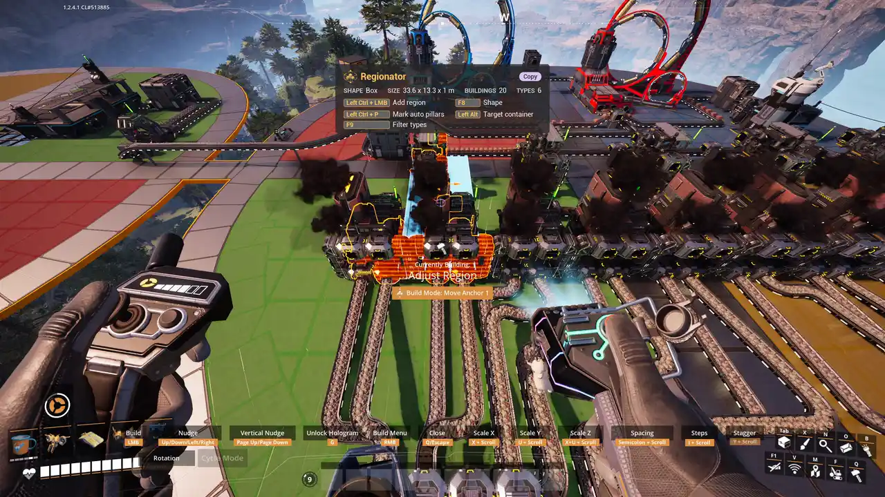

# Copy

Turns your selection into a hologram you can place as often as you like, at the normal build cost.

## How to use it

1. Pick **Copy**, draw a [region](Regions), confirm.
2. Place the hologram as many times as you like. Each placement is paid from [targeted
   containers](Container-Targeting) first, then from your inventory and the Dimensional Depot, as
   the game pays for any build.
3. Put the hologram away when you are done.

## Notes

- With [Snap to Origin](Snap-To-Origin), each new copy starts where you placed the last one, so
  nudge and place makes evenly spaced rows.
- **Save each Copy as a blueprint** (Mods menu) keeps each Copy under **Regionator > Copy History**
  in the blueprint menu.
- The HUB and the Space Elevator are left out, since they can only be built once.
- What a copy carries and costs is on [Blueprints and Cost](Blueprints-And-Cost).
