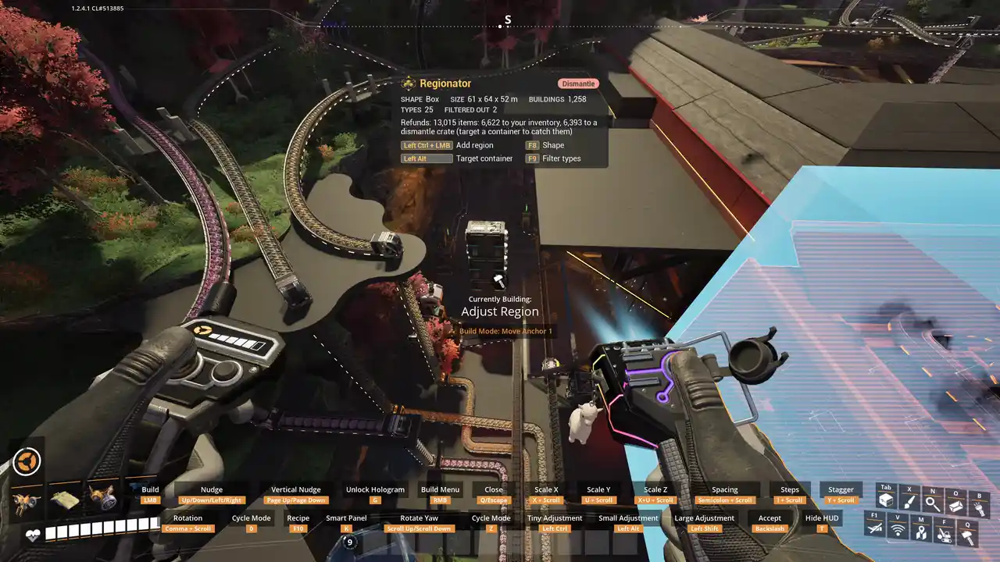

# Dismantle

Hands your selection to the game's own dismantle tool, with the refund shown before you fire.

## How to use it

1. Pick **Dismantle**, draw a [region](Regions), confirm.
2. The game's dismantle tool comes up holding the selection, and the [HUD](Regionator-HUD) shows
   the refund and where it will go. Above 3000 buildings the refund is not estimated, but you
   still get it.
3. Fire to dismantle, or use secondary fire to cancel.

## Notes

- The game's multi-select keys still add or remove buildings before you fire.
- A belt or power line the region touches is dismantled whole, even the part outside it.
- Refunds go to [targeted containers](Container-Targeting), then your inventory, then a dismantle
  crate.
- Vehicles (trucks, tractors, explorers, drones, trains) are selected too. Only Dismantle selects
  them; leave them out with the [type filter](Type-Filtering).
- Dismantles of 100 buildings or more run in the background, and the HUD shows progress. Once
  started, a dismantle runs to the end.
- Buildings that a [Move](Move), [Copy](Copy) or [Save Blueprint](Save-Blueprint) is still working
  on cannot be dismantled until it finishes.

## Dismantle limit

The game caps how many buildings one dismantle can hold. **Dismantle limit** in the Mods menu sets
that cap, from 100000 to 1000000, for the game's own dismantle tool too. With Infinite Dismantle
installed, Regionator's limit is used.
