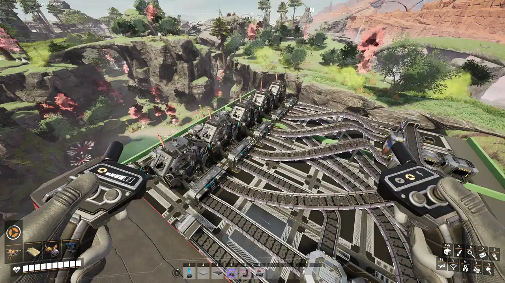

# Fill Inputs

Fills the inputs of every production machine and solid-fuel generator in the region from
[targeted containers](Container-Targeting) and your inventory. Fluids are not filled, and machines
with no recipe are skipped.

## How to use it

1. With the tool equipped, [target](Container-Targeting) one or more containers holding the
   ingredients.
2. Pick **Fill inputs**, draw a [region](Regions) over the machines, confirm.
3. Items are split evenly across the machines that accept them.

The [type filter](Type-Filtering) gains an **Items to fill** list: unticked items are not filled.
