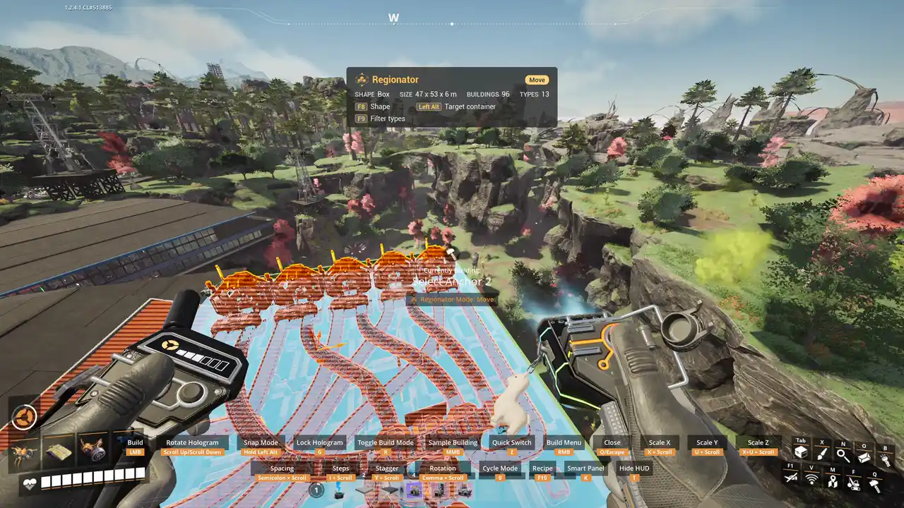

# Move

Picks up your selection as a hologram, at no cost, to place somewhere else. Machine contents, belt
items and pipe fluid come along. Once the buildings stand in their new place, the originals are
removed.

## How to use it

1. Pick **Move**, draw a [region](Regions), confirm.
2. Place the hologram. Secondary fire cancels the move, and nothing changes.

## Placement

- The hologram may overlap the originals, so a machine can be nudged into the space it already
  occupies.
- [Snap to Origin](Snap-To-Origin) puts the hologram exactly on the originals, so you can nudge it
  a known distance.
- Belt and pipe ends are reconnected to what the originals were connected to outside the
  selection, so a segment can be moved and put back into its gap.

## The edges of the selection

A belt or power line that runs out of the selection is outlined but does not move: it stays where
it is. Railroad tracks only reconnect where the game's own Auto-Connect joins them.

## Safety

A Move never removes an original unless its moved building stands: if one is missing, the
original stays. If the game refuses to remove an original (a railway with a train on it), the
moved building is taken down instead, so you never end up with both.

Until the originals are removed, nobody can dismantle them. A save made in that moment, usually a
second or two, waits until they are gone, so the save never holds both.

## Move History

**Save each Move as a blueprint** (Mods menu) keeps each Move under **Regionator > Move History**
in the blueprint menu. Only the Move itself is free: built from the menu, it costs its normal
cost. A Move holding the HUB or the Space Elevator is never kept.
