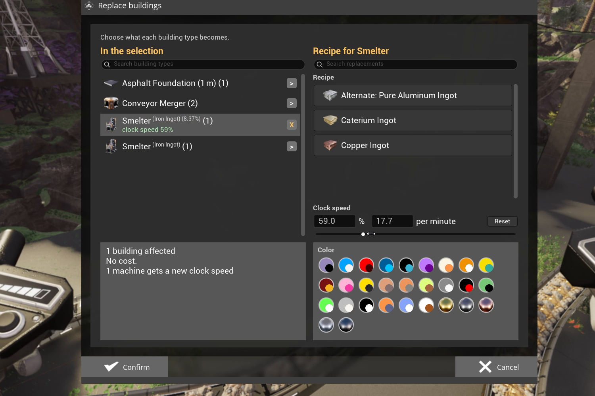

# Replace

Swaps foundations, walls, belts, pipes and more for another type, material or color, in place.
It can also set machine recipes and clock speeds, change miner tiers, and edit signs.
Connections, contents and positions are kept.

## How to use it

1. Pick **Replace**, draw a [region](Regions), confirm.
2. A popup lists the building types in the selection, with the cost and refund under them. Click
   a row, then choose on the right what it becomes, a color, or both. The **Replace** button grays
   out when you cannot afford it.
3. Confirm the popup.

The color palette has a search box. Click its heading to fold it away.

## What can become another type

Foundations, walls, ramps, roofs, beams, pillars and other architecture, belts, lifts, pipes,
hypertubes, and floor and wall holes. A replacement must fit the same footprint (belts with belts,
pipes with pipes, beams with beams), and only unlocked recipes are offered.

Miners can change tier, up or down. The new miner keeps the node, its connections, the ore inside,
its power shards and its clock speed.

Everything else (machines, splitters, mergers, pumps, power poles, lights) keeps its type and only
takes the new material and color.

## Recipes and clock speed

A machine row can set a new **recipe**. The machine is emptied and items the new recipe cannot use
are handed back; fluid it cannot use is lost, as when you change the recipe by hand.

Machines with a clock speed get a **Clock speed** section: type a percentage, drag the slider, or
type the output per minute. **Reset** puts the row back to its current clock speed. Machines of
one type at different clock speeds get separate rows. Above 100%, missing power shards are part of
the cost, and shards no longer needed are handed back.

## Signs

Signs that look exactly the same share a row. When signs of one type look different, each look
gets its own numbered row. The search also finds signs by their text. Open a sign row to edit its
layout, texts, icons, colors, glow (**Emission**) and finish (**Surface**), with a live preview.

The sign settings have their own **Copy** and **Paste** buttons, to carry settings from one sign
row to another, even between sign sizes; only what the target sign supports is applied. **Reset**
undoes your changes to the row.

In [multiplayer](Multiplayer), signs your game has not received yet show as "(not loaded)".

## What is kept

Position, curve, length, connections, belt items and pipe fluid. Items that cannot go back on a
belt (for example, it runs into an unpowered machine) are handed back. Throughput monitors are
rebuilt on the new belt.

## Cost

Each replacement costs the new building, less the refund of the old one, scaled by length for
belts, pipes and beams. Recipe and sign changes are free. Costs are paid from [targeted
containers](Container-Targeting), then your inventory, then the Dimensional Depot. Refunds go to
your targeted containers, then your inventory, then a crate at your feet, never to the Depot.
Under the game's No Build Cost, replacements are free and give nothing back.

## Left alone

A building that a player's hover pack is drawing power from, or whose removal would take down
something Replace cannot put back. The HUD lists the reasons when the Replace finishes.
