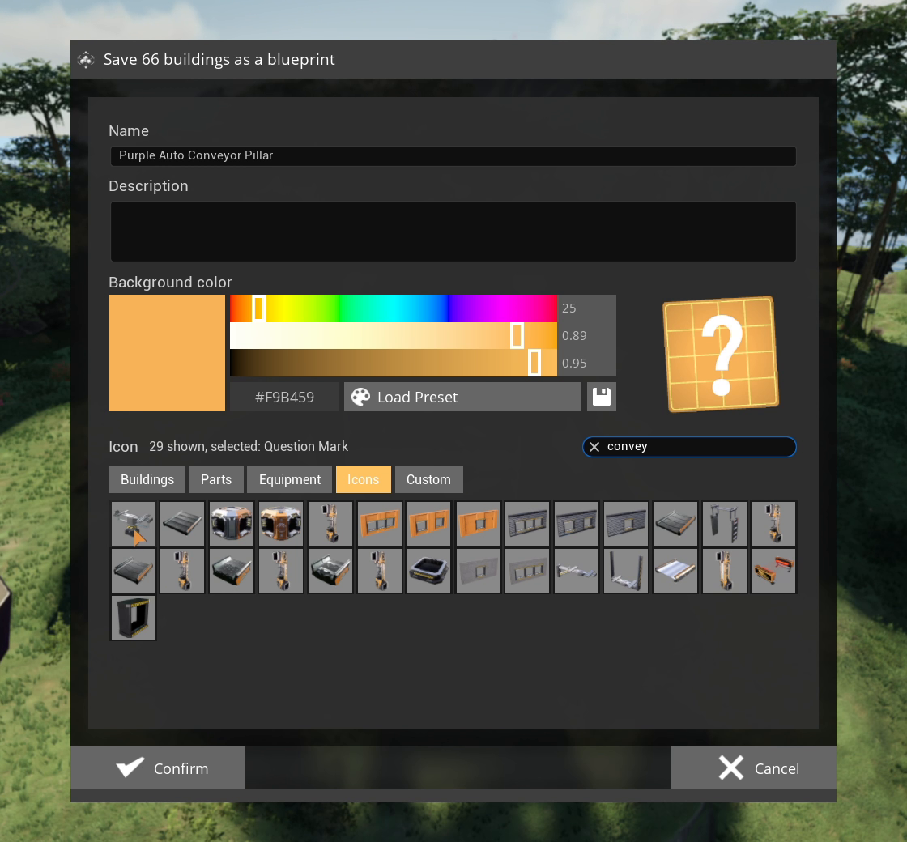

# Save Blueprint

Saves any region as a normal blueprint, without the Blueprint Designer.

## How to use it

1. Pick **Save Blueprint**, draw a [region](Regions), confirm.
2. Enter a name and description, and pick a color and icon.
3. Save. The blueprint is filed under **Regionator > Blueprints** in the blueprint menu.

## Notes

- The HUB and the Space Elevator are left out, since they can only be built once.
- With [Auto Pillars](Auto-Pillars) on, mark the pillars before you confirm.
- What a blueprint carries and costs is on [Blueprints and Cost](Blueprints-And-Cost).
- Save Blueprint unlocks the blueprint menu even before the blueprint milestone. Before removing
  the mod from such a save, untick **Enable Save Blueprint** in the Mods menu, then load the save
  and save it once. Otherwise the blueprint menu stays unlocked without the mod.
