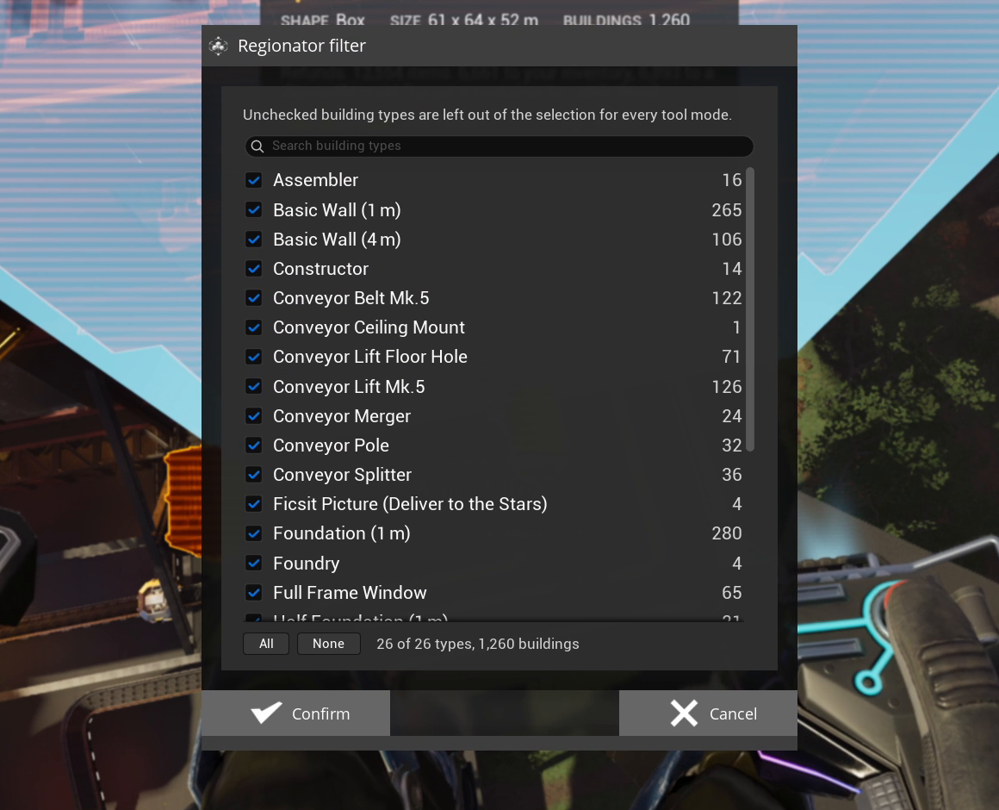

# Type Filtering

Leave building types out of the selection, in every mode.

## How to use it

1. With a region drawn, press **Regionator: filter building types** (`L`).
2. Untick the types to leave out. The outlines and the [HUD](Regionator-HUD) follow.
3. Confirm the popup to keep your choice, or cancel to undo it.

## Notes

- The search box matches letters in order, so `aspfnd` finds Asphalt Foundation.
- The filter stays in every mode until you change it or restart the game. While it removes
  something, the HUD shows how many.
- [Fill Inputs](Fill-Inputs) and [Clear Items](Clear-Items) add a list of items to fill or clear.
