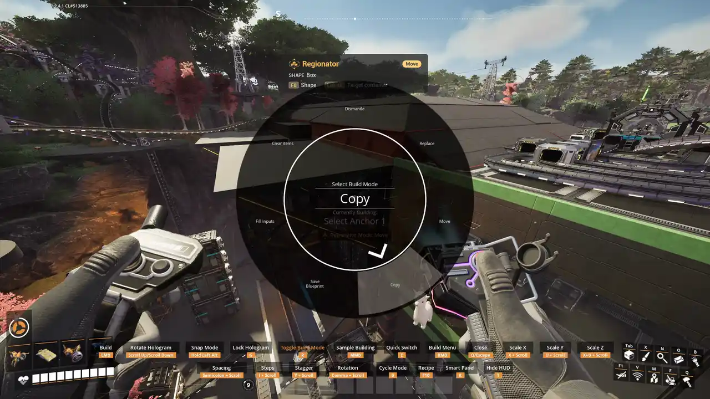

# Quick Start

Regionator is free and unlocked from the start.

## Your first dismantle

1. Equip the tool: build menu > **Special** > **Selection** > **Regionator**, or press `J`
   (`L3 + LB` on a controller).
2. Press the build-mode key and pick **Dismantle**.
3. Aim at one corner of what you want to remove and click to place the first corner.
4. Aim at the opposite corner, higher or lower to cover several floors. Everything inside is
   outlined. Click to place the second corner.
5. The box locks in place, so you can nudge or rotate it if it is not quite right. Click again to
   confirm.
6. The game's dismantle tool comes up holding everything inside, and the HUD shows the refund.
   Fire to dismantle.

Changed your mind? Before you confirm, secondary fire steps back one stage each press: from the
locked box to the second corner, then to the first. In the dismantle tool, secondary fire cancels.
Nothing is removed until you fire.

## Next steps

- The build-mode key picks the mode: Dismantle, Replace, Move, Copy, Save Blueprint, Fill inputs
  or Clear items. Each has its own page.
- `Left Ctrl + B` switches to a [sphere](Regions).
- `Left Ctrl + N` adds [another region](Regions).
- `L` opens the [type filter](Type-Filtering).
- Tap `Left Alt` on a storage container to [target it](Container-Targeting).

See [Controls](Controls) for every key, and [Controller and Steam Deck](Controller) for the pad.
