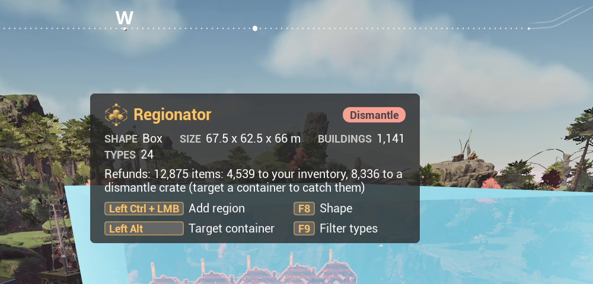

# Regionator HUD

The HUD is the mod's on-screen readout. It shows what the tool is doing right now.

## While shaping a region

- **Badge**: the current mode, in its own color.
- **Chips**: the region's shape and size, and how many buildings and types it holds. Also how many
  are marked as [auto pillars](Auto-Pillars) or removed by the [type filter](Type-Filtering).
- **Estimate**: what confirming would do, for example the refund and where it goes. Warnings show
  here in amber.
- **Keys**: the keys you can use right now, for keyboard or controller.

## During an operation

While a dismantle is held, or a Move or Copy is placed, the HUD shows the cost or refund and
where it goes. Long operations show a progress bar.

Position and size are set under **Mods > Regionator > HUD**; see the
[Options Reference](Options-Reference).
